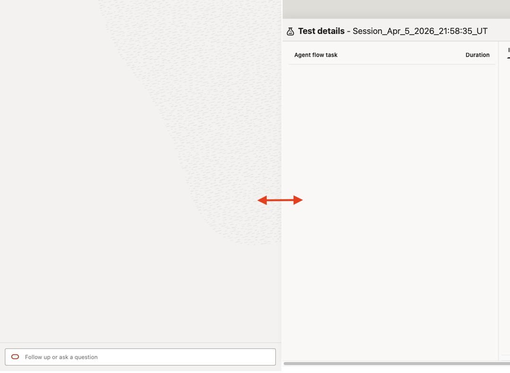
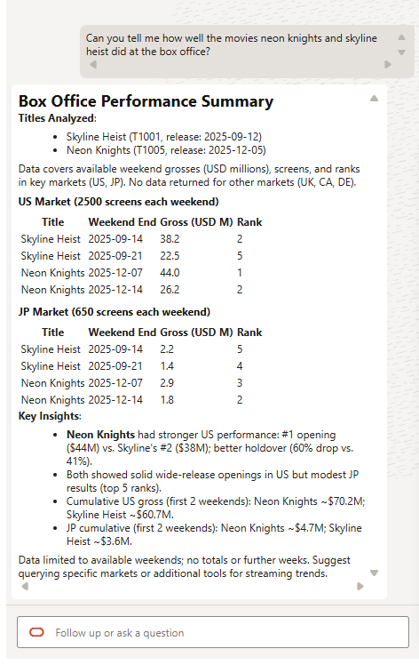
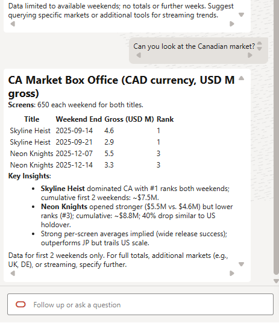
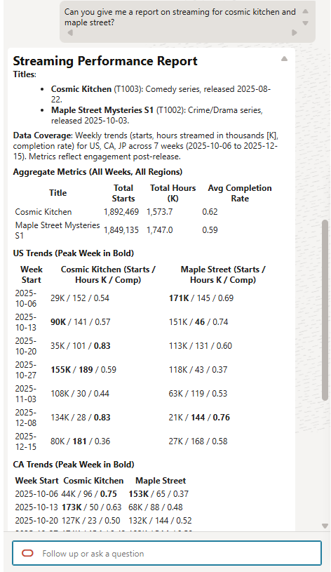
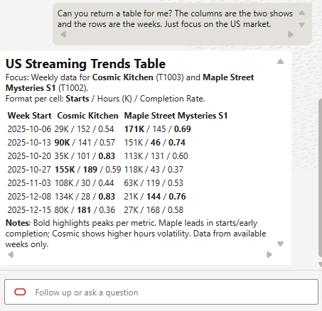
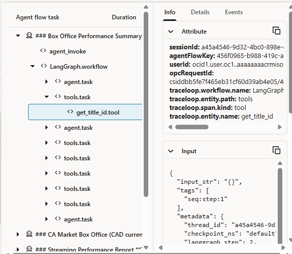

# Lab 3: Validate the Agent Flow

## Introduction

The agent is built — now it's time to see it in action. In this lab, you'll use the Agent Flow Playground to test the Entertainment Release & Performance Analyst agent with a series of real-world questions that span box office analysis, streaming health, and cross-title comparisons. Each test is designed to exercise a different combination of the agent's tools (RAG, SQL, or both) and demonstrate how the agent reasons across structured and unstructured data to serve marketing, finance, and content strategy teams.

Pay close attention to how the agent decides which tools to call, how it resolves title names to IDs (even with typos), and how it synthesizes results into clear, actionable business language.

**Estimated Time:** 15 Minutes

> **Sample data:** This workshop uses fictional historical data. Ask for the latest available sample weeks, not the current calendar period. Completion values are fractions: `0.44` means 44%. Compare the same dates and markets, and do not assume every supplied record is a consecutive week. Marketing tables are seeded for future extensions; this agent has no marketing SQL tool.

### Objectives

In this lab you will:

1. Open the Agent Flow Playground and create a test session
2. Test the agent with a multi-title box office question — observing how it resolves title names and handles typos
3. Test market-specific follow-ups to see how the agent maintains conversational context
4. Test streaming performance with a cross-title comparison request
5. Test a RAG-only policy and definition question
6. Test a hybrid RAG-plus-SQL interpretation question
7. Test the agent's ability to produce structured tabular output on demand

### Prerequisites

This lab assumes you have:

* Completed Lab 2 (Agent Flow Setup)
* The agent flow attached to an active AI Compute
* A Chat Trigger connected to the Executor Agent, with all tools (1 RAG + 4 SQL) configured and connected.

## Task 1: Open the Playground

The Playground is a built-in testing environment where you can create sessions and have conversations with your agent flow before deploying it to production.

1. From the agent flow canvas, click the **Playground** located just above the canvas. This reveals the Playground panel.

2. Confirm a session is selected, or select **Create New Session**. Keep this session for the follow-up tests. You can type natural language questions in the chat input and the agent will reason, call tools, and respond — just as it would in production.

    > **Tip**: As you test, watch the tool call indicators. The Playground shows which tools the agent invokes, what parameters it passes, and what data comes back. This transparency is invaluable for understanding and debugging the agent's reasoning.

3. You can widen the chat session window by clicking on the vertical divider, holding the mouse button down and moving the cursor to the right.

    

## Task 2: Test Box Office Performance — Multi-Title Query

In this step, you'll ask the agent about box office performance for two movies. Notice how the agent handles a misspelled title name ("skyline hiest" instead of "skyline heist") — it should use the `get_title_id` tool to resolve the correct title.

1. In the Playground chat, enter the following prompt:

    ```
    <copy>
    Using the available historical sample weekends, compare neon knights and skyline hiest at the US box office. Show the dates, gross, screens, and rank. Compare their first two recorded weekends, and label the two-week totals rather than calling them lifetime grosses.
    </copy>
    ```

2. Observe the agent's response. It should:
    - Recognize both title names (despite the typo in "skyline hiest")
    - Call the `get_title_id` tool to resolve the title names to their IDs
    - Call the `get_box_office_weekend` tool for each title
    - Return box office gross, screen counts, and ranking data
    - Present the results in structured, business-friendly language

    

    > Observe the behavior: The agent identifies both titles, resolves the typo, retrieves box office data, and presents a comparative summary.

> **Check the evidence:** Skyline Heist has two US weekends, September 14 and 21, 2025, totaling $60.7M. Neon Knights has December 7 and 14, 2025, totaling $70.2M. These are different release windows, not a same-week head-to-head comparison.

## Task 3: Test Market-Specific Follow-Up

Now test the agent's ability to handle a follow-up question that narrows the scope to a specific market. The agent should maintain context from the previous question.

1. In the same session, enter the following prompt:

    ```
    <copy>
    Can you look at the Canadian market for those same two movies? Keep the first-two-recorded-weekends comparison and show the local ranks as well as gross.
    </copy>
    ```

2. Observe the agent's response. It should:
    - Understand from context that you're still asking about Neon Knights and Skyline Heist
    - Resolve "canadian market" to the appropriate market code (CA)
    - Call the `get_box_office_weekend` tool with the Canadian market code for both titles
    - Present the Canadian box office results

    
    > Observe the behavior: The agent maintains conversational context, resolves the market name to a code, and returns Canada-specific box office data for both titles.

> **Check the evidence:** Canada totals are $7.5M for Skyline Heist and $8.8M for Neon Knights. Skyline ranks 1 in each recorded Canadian weekend; Neon ranks 3. Higher gross across different windows does not imply a better local weekly rank.

## Task 4: Test Streaming Performance — Multi-Title Comparison

This step shifts to streaming data and tests the agent's ability to handle a completely different data domain within the same session.

1. In the same session, enter the following prompt:

    ```
    <copy>
    Compare cosmic kitchen and maple street in the US over their latest four available sample weeks. Show weekly starts and completion percentages for matching dates. Which title has stronger reach, and which has healthier completion?
    </copy>
    ```

2. Observe the agent's response. It should:
    - Resolve the title names (which may be partial or informal) using `get_title_id`
    - Call `get_streaming_trend` for each title
    - Return weekly streaming metrics: starts, hours streamed, and completion rates
    - Present the data as a comparative report

    

    > Observe the behavior: The agent switches data domains from box office to streaming seamlessly, retrieves multi-week trend data for both titles, and presents it in a report format.

> **Observe the behavior:** Cosmic Kitchen has more starts but declining completion; Maple Street has fewer starts and improving completion. The comparison should cover October 27, November 3, November 10, and November 17, 2025.

## Task 5: Test RAG-Only Policy Guidance

This step tests whether the agent uses the RAG tool when the question asks for an internal definition, policy, or escalation guideline rather than structured performance data.

1. In the same session, enter the following prompt:

    ```
    <copy>
    Using the internal playbooks, define completion rate and explain the exact escalation condition for low completion. State whether the documents specify green/yellow/red bands or numerical genre-specific benchmarks; do not invent them.
    </copy>
    ```

2. Observe the agent's response. It should:
    - Call the `internal_knowledge_sources_rag` tool
    - Define completion rate using the internal playbooks
    - Explain the documented below-45%-for-two-consecutive-weeks rule and its top-three-region condition; disclose any missing color-band definitions
    - Include genre-specific considerations if the playbooks provide them

## Task 6: Test Hybrid RAG + SQL Interpretation

This step tests whether the agent can combine internal playbook guidance with structured streaming performance data.

1. In the same session, enter the following prompt:

    ```
    <copy>
    For this scenario, treat the US as a top-three region. Retrieve the internal completion-rate escalation rule, then apply it to Cosmic Kitchen's latest four available US sample weeks. Cite the dates and completion percentages that do or do not satisfy the rule. Separate the observed trend from any proposed action, and do not infer that marketing caused it.
    </copy>
    ```

2. Observe the agent's response. It should:
    - Use RAG to retrieve the completion-rate escalation rule
    - Resolve Cosmic Kitchen to the correct title ID
    - Call `get_streaming_trend` for the US region
    - Interpret the latest four available sample weeks against the documented escalation condition; distinguish two consecutive weeks from two arbitrary records
    - Call out any escalation risk clearly

> **Observe the behavior:** Cosmic Kitchen completion is 55%, 50%, 44%, and 40%. November 10 and 17 are consecutive weeks below 45%; with the scenario's top-three-region assumption, they meet the documented escalation condition. The tool results do not establish the cause of the decline.

## Task 7: Test Structured Output — Custom Table Format

This final test evaluates the agent's ability to produce formatted tabular output when explicitly requested.

1. In the same session, enter the following prompt:

    ```
    <copy>
    Return a completion-rate table for Cosmic Kitchen and Maple Street for the latest four available US sample weeks. Put shows in columns and week-start dates in rows, and format completion as percentages.
    </copy>
    ```

2. Observe the agent's response. It should:
    - Understand the request for a specific table layout (shows as columns, weeks as rows)
    - Filter to the US market only
    - Re-query if necessary, or restructure the data from the previous response
    - Return a clean, well-formatted table comparing both shows week by week

    

    > Observe the behavior: The agent restructures the data into the requested pivot-style table format, with weeks as rows and the two show titles as column headers, filtered to US market only.

3. Before wrapping things up, you might consider exploring the **Agent flow task** list to the right of the chat window. You can expand each task to see the workflow, agent tasks, tool tasks, etc.

    

## Task 8: Reflect on the Agent's Behavior

Before moving on, take a moment to consider what just happened across the test session.

1. **Tool selection**: The agent automatically determined which tools to call based on each question — RAG for policy questions, SQL for metrics, reference lookups for resolving names and codes, and RAG-plus-SQL for interpretation questions.

2. **Context retention**: The agent maintained conversational context across turns — understanding that "these movies" referred to Neon Knights and Skyline Heist, and that the streaming question introduced new titles.

3. **Error tolerance**: The agent handled a misspelled title name ("skyline hiest") by using the reference lookup tool rather than failing.

4. **Output flexibility**: The agent adapted its response format from narrative summaries to structured tables based on the user's explicit request.

    > **Discussion prompt**: "If this agent were available to your team today, what would be the first question you'd ask about your current release? What additional data sources or tools would make it more useful?"

## Lab 3 Recap

In this lab, you validated the Entertainment Release & Performance Analyst agent across a comprehensive set of real-world scenarios:

- Multi-title box office queries with typo handling
- Market-specific follow-ups with conversational context retention
- Cross-title comparative analysis
- Streaming performance reports across a different data domain
- RAG-only policy and definition guidance
- Hybrid RAG-plus-SQL interpretation of streaming completion-rate risk
- Custom structured output formatting on demand

The agent successfully combined RAG (internal policy documents) and SQL (structured database queries) to serve the kinds of questions that marketing, finance, and content strategy teams ask every day. In the next lab, you'll deploy the agent to a production endpoint.

## Learn More

* [Oracle AI Data Platform — Sample Agent Flows on GitHub](https://github.com/oracle-samples/oracle-aidp-samples/tree/main/ai/agent-flows)
* [Oracle AI Data Platform — Documentation](https://docs.oracle.com/en/cloud/paas/ai-data-platform/)

## Acknowledgements

* **Author(s)** - Jean-Rene Gauthier [AIDP]
* **Contributors** - Eli Schilling - Cloud Architect, Gareth Nathan - SDE, GenAI
* **Last Updated By/Date** - Eli Schilling, October 2026
