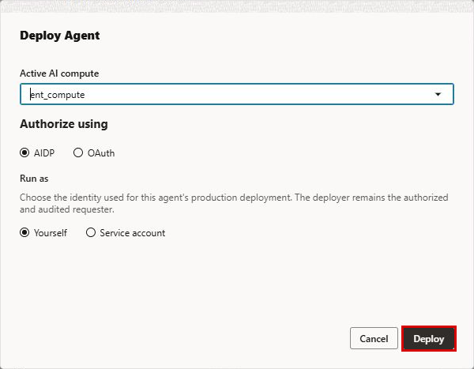
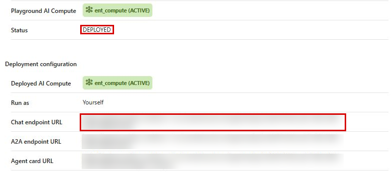

# Lab 4: Deploy the Agent Flow

## Introduction

You've built and validated the Entertainment Release & Performance Analyst agent. The final step is to deploy it to a production endpoint so it can be accessed by applications, integrations, and users beyond the Playground. In this lab, you'll deploy the agent flow to an AI Compute, retrieve the production endpoint URL, and understand how the deployed agent can be consumed via REST API.

Deployment transforms the agent from a development artifact into a live service that your marketing, finance, and content strategy teams can access through internal tools, dashboards, or custom applications.

**Estimated Time:** 5 Minutes

### Objectives

In this lab you will:

1. Deploy the agent flow to an AI Compute
2. Retrieve the production endpoint URL
3. Understand how the deployed agent can be consumed via REST API

### Prerequisites

This lab assumes you have:

* Completed Lab 3 (Validate the Agent Flow)
* An active AI Compute
* A fully configured and tested agent flow

## Task 1: Deploy the Agent Flow

1. From the agent flow canvas, click the **Deploy** button in the upper right corner.

2. In **Deploy Agent**, select **`ent_compute`** under **Active AI compute**. Keep **Authorize using: AIDP** and **Run as: Yourself**. Do not select OAuth or a service account for this workshop.

3. Click **Deploy** and wait for the deployment to complete. The status will update to indicate a successful deployment.

    

    > **Note:** Deployment runs asynchronously. Check **Async operations** for **Deploy Agent: Succeeded**. If Details still shows DRAFT immediately afterward, switch to Flow and back to Details to refresh it.

## Task 2: Retrieve the Chat Endpoint URL

Once the deployment is successful, you need to retrieve the production URL that applications will use to communicate with the agent.

1. Navigate to the **Details** tab of your agent flow.

2. Confirm status **DEPLOYED** and locate the **Chat endpoint URL** (or **Endpoint URL** in an earlier interface). This is the production URL of your deployed agent flow. Copy this URL — it is the address that external applications, scripts, or integration tools will use to send messages to the agent.

    

3. Note that the deployed agent is now a live REST endpoint. It accepts messages and returns responses using the same reasoning, tools, and knowledge that you validated in the Playground.

## Task 3: Understand REST API Consumption

Once deployed, the agent flow endpoint can be called programmatically via `curl`, Python, or any HTTP client. While executing REST API calls is beyond the scope of this workshop, review the integration model below. Confirm the supported request format and authentication for the deployment before writing a client; the JSON shown is illustrative, not a validated standalone API invocation:

1. **Authentication**: Use the authentication mechanism supported by the deployed endpoint and the event environment. A signed-in Playground session does not prove an external client is authorized. Do not copy browser cookies into scripts.

2. **Sending messages**: Callers send a POST request to the endpoint URL with a JSON body containing the user's message. For example:

    ```json
    {
      "message": "How did Neon Knights perform in the US last weekend?"
    }
    ```

3. **Conversational context**: The supported API can return a conversation identifier. Use the field documented for that endpoint version on subsequent requests to maintain conversational context across turns — just like the multi-turn session you tested in the Playground.

4. **Integration options**: The endpoint can be integrated with internal dashboards, Slack bots, custom web apps, Oracle Digital Assistant, or any tool that can make HTTP requests. This means marketing, finance, and content strategy teams can access the agent from the tools they already use.

    > **Key takeaway**: Deployment turns your agent from a prototype into a production service. The REST endpoint makes it accessible to any application or integration, while OCI IAM ensures only authorized users and systems can access it. The deployment still needs endpoint access checks, monitoring, and retrieval evaluation before production use.

## Lab 4 Recap

In this lab, you completed the final step of the end-to-end agent development lifecycle:

- You **deployed** the agent flow to an AI Compute, creating a live production endpoint.
- You **retrieved the endpoint URL** that applications and integrations use to communicate with the agent.
- You **understand the REST API model** for consuming the agent — including authentication, message format, conversational context, and integration options.

The Entertainment Release & Performance Analyst agent is now a deployed demonstration service that can serve marketing, finance, and content strategy teams across your organization.

## Learn More

* [Oracle AI Data Platform — Documentation](https://docs.oracle.com/en/cloud/paas/ai-data-platform/)
* [Oracle AI Data Platform — Sample Agent Flows on GitHub](https://github.com/oracle-samples/oracle-aidp-samples/tree/main/ai/agent-flows)
* [From Vision to Velocity: How Oracle AI Database Private Agent Factory Rewires Enterprise Innovation — Oracle Blog](https://blogs.oracle.com/database/our-experience-with-oracle-ai-database-private-agent-factory)

## Acknowledgements

* **Author(s)** - Jean-Rene Gauthier [AIDP]
* **Contributors** - Eli Schilling - Cloud Architect, Gareth Nathan - SDE, GenAI
* **Last Updated By/Date** - Eli Schilling, October 2026
